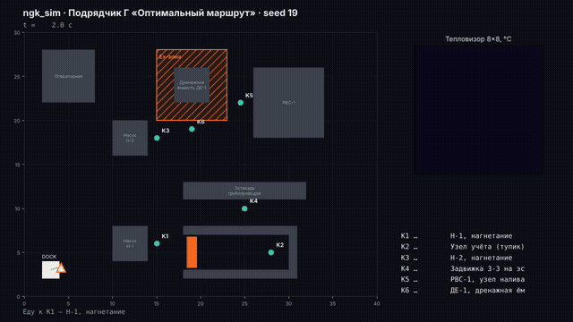
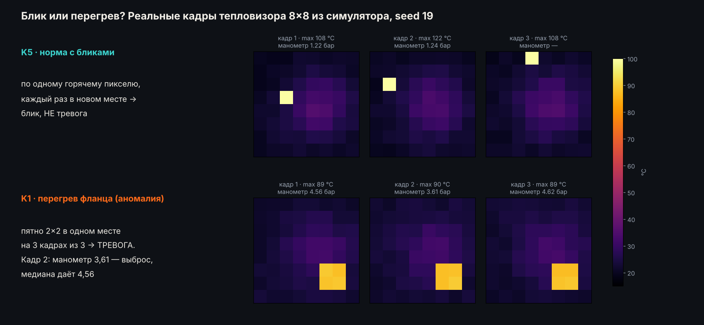
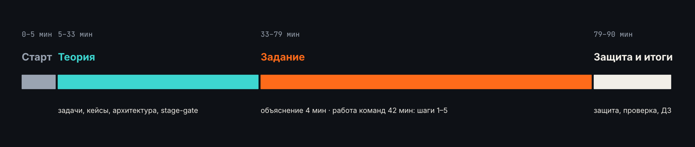
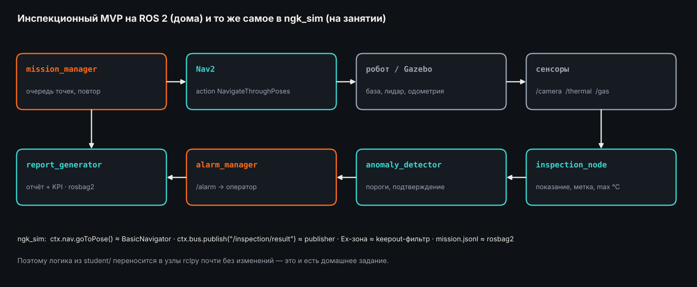
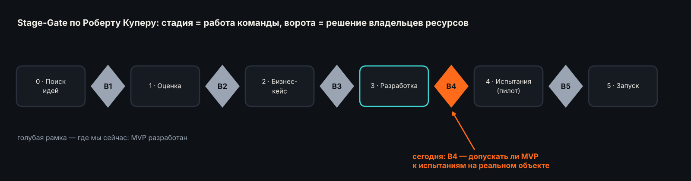
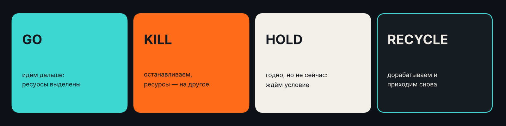
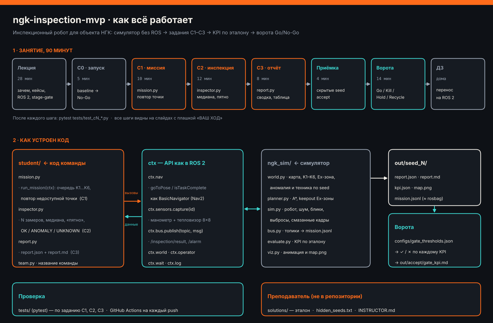
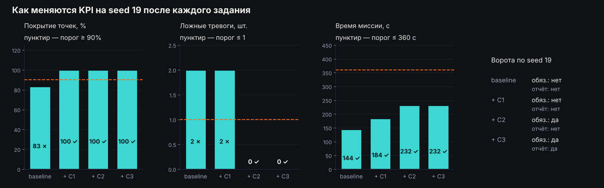

# Инспекционный MVP робота для объекта НГК: оценка на стадийных воротах Go/No-Go

[](https://github.com/ulyan17/inspection-robot-gate-review/actions/workflows/ci.yml)

Практическое занятие курса «Газпром нефти» в СПбПУ, 90 минут.

Четыре подрядчика представили MVP робота-инспектора для насосной станции. Студенты работают как комиссия на стадийных воротах В4: по записям испытаний проверяют заявления подрядчиков, устанавливают причины провалов и принимают решение о допуске к пилоту на реальном объекте.

На занятии ничего не устанавливается и не запускается. Все прогоны записаны заранее и лежат в папке [`evidence/`](evidence/README.md). Запуск симулятора, доработка собственного робота и перенос на ROS 2 вынесены в домашнее задание.

<table>
<tr>
<td width="25%"><a href="evidence/A/README.md"></a><br><b>А «Быстрый обход»</b></td>
<td width="25%"><a href="evidence/B/README.md"></a><br><b>Б «Надёжный»</b></td>
<td width="25%"><a href="evidence/C/README.md"></a><br><b>В «Сбалансированный»</b></td>
<td width="25%"><a href="evidence/D/README.md"></a><br><b>Г «Оптимальный маршрут»</b></td>
</tr>
</table>

| | |
|---|---|
| Длительность | 90 минут: теория 28, задание 46 (объяснение 4, работа 42), защита и итоги 11 |
| Формат | команды по 3–4 человека, один ноутбук на команду |
| Необходимо на занятии | браузер и Word или Google Документы; аккаунт GitHub не нужен |
| Данные | [`evidence/`](evidence/README.md): анимации, карты, логи, отчёты, замеры датчиков, код подрядчиков |
| Сдаётся | заполненный шаблон протокола [`gate_protocol.docx`](https://github.com/ulyan17/inspection-robot-gate-review/raw/main/submission/gate_protocol.docx) |
| Домашнее задание | установка, запуск, доработка робота, перенос на ROS 2 — [`homework/`](homework/README.md) |

## Содержание

1. [Задание](#задание)
2. [Порядок выполнения](#порядок-выполнения)
3. [Требования к ответам](#требования-к-ответам)
4. [Оценивание](#оценивание)
5. [План занятия](#план-занятия)
6. [Теория](#теория)
7. [Объект и данные](#объект-и-данные)
8. [Защита](#защита)
9. [Домашнее задание](#домашнее-задание)
10. [Справочник](#справочник)

---

## Задание

Компания готовит пилот робота-инспектора на насосной станции. Четыре подрядчика прислали MVP и коммерческие предложения:

| | Подрядчик | Заявление |
|---|---|---|
| А | «Быстрый обход» | полный обход за 2,5 минуты, одного замера на точку достаточно |
| Б | «Надёжный» | 100% точность и ни одной ложной тревоги, при сомнениях подключается оператор |
| В | «Сбалансированный» | выполняет все обязательные критерии заказчика |
| Г | «Оптимальный маршрут» | лучшие KPI среди всех, без участия оператора |

Команда выступает комиссией на воротах В4 и должна:

1. проверить каждое заявление по записям испытаний;
2. определить, какие критерии ворот не выполнены и как часто;
3. установить причину каждого провала и подтвердить её данными и кодом;
4. принять решение по каждому подрядчику и выбрать кандидата на пилот или отказать всем;
5. защитить решение за 2 минуты.

Результат — заполненный протокол в Word (7 страниц):

| Страница | Содержание |
|---|---|
| 1 | команда, роли, порядок заполнения |
| 2 | таблица 1 — показатели демо-прогона; таблица 2 — сводки по 5 и 30 сценариям |
| 3–6 | по странице на подрядчика: измерения, проверенный сценарий, причина, два доказательства, решение, что исправить |
| 7 | кандидат на пилот, обоснование, два риска, мнение о порогах ворот |

---

## Порядок выполнения

Работа занимает 42 минуты и выполняется по шагам. Каждый шаг указывает, что открыть, что проверить и что записать.

### Шаг 1. Подготовка — 2 минуты

1. Открыть репозиторий: https://github.com/ulyan17/inspection-robot-gate-review
2. Скачать шаблон протокола: [gate_protocol.docx](https://github.com/ulyan17/inspection-robot-gate-review/raw/main/submission/gate_protocol.docx). Открыть в Word или Google Документах.
3. Распределить роли:
   - докладчик — ведёт защиту;
   - аналитик данных — работает с картами, логами и замерами;
   - ответственный за протокол — заполняет шаблон.
4. Заполнить первую страницу: команда, группа, дата, ФИО по ролям.

Результат: заполнена страница 1.

### Шаг 2. Демо-прогон — 9 минут

Источник: материалы подрядчиков [А](evidence/A/README.md), [Б](evidence/B/README.md), [В](evidence/C/README.md), [Г](evidence/D/README.md), раздел 1 «Демо-прогон (seed 19)». Около 2 минут на подрядчика.

Для каждого подрядчика:

1. Прочитать заявление в начале страницы.
2. Просмотреть анимацию. Отметить маршрут, цвет точек контроля (зелёный — норма, оранжевый — тревога, серый — не проверена) и отметки внутри Ex-зоны.
3. Раскрыть блок «Отчёт подрядчика» и выписать в таблицу 1: сколько точек проверено из 6 и сколько тревог поднято.
4. Раскрыть блок «Лог миссии и итог» и выписать в таблицу 1: время миссии, число шагов в Ex-зоне, число ручных вмешательств. По строке «Истина этого seed» определить, была ли тревога на точке с аномалией.
5. Сравнить результат с заявлением и записать одно-два наблюдения в поле «Измерения показали» на странице подрядчика.

В конце шага записать под таблицей 1, чьё заявление не подтвердилось уже на демо-прогоне.

Результат: заполнена таблица 1 (4 строки), черновики «Измерения показали».

### Шаг 3. Сводки по 5 и 30 сценариям — 8 минут

Источник: [`evidence/compare.md`](evidence/compare.md) — 5 одинаковых сценариев приёмки; [`evidence/compare_30.md`](evidence/compare_30.md) — 30 случайных сценариев.

1. В разделе 1 обоих файлов найти строку «Все обязательные сразу». Перенести значения в таблицу 2.
2. Для каждого подрядчика выписать обязательные критерии, выполненные меньше чем в 100% прогонов, с долей на 5 и на 30 сценариях.
3. В разделе 3 файла `compare.md` («По каждому сценарию») выписать номера сценариев, в которых подрядчик не выполнил обязательные критерии. Они нужны на шаге 4.
4. Сравнить результаты на 5 и на 30 сценариях. Отметить подрядчика, у которого они заметно различаются.
5. Дополнить поле «Измерения показали» цифрами.

Результат: заполнена таблица 2, в «Измерения показали» указаны критерии и доли прогонов.

### Шаг 4. Анализ причин — 15 минут

Источник: материалы подрядчика, раздел 2 «Приёмка: 5 сценариев» и раздел 3 «Код подрядчика». Около 4 минут на подрядчика; подрядчиков можно разделить между участниками.

Для каждого подрядчика:

1. Выбрать проваленный сценарий из таблицы 2 и записать его номер в поле «Проверенный сценарий».
2. Открыть карту этого сценария: какие точки серые или оранжевые, есть ли отметки в Ex-зоне, куда ведёт маршрут.
3. Раскрыть «Лог миссии и итог»: какие сообщения повторяются, какой критерий провален, где была аномалия на самом деле.
4. Раскрыть «Отчёт подрядчика»: что робот доложил по каждой точке и совпадает ли это с истиной.
5. Раскрыть «Замеры датчиков»:
   - сколько кадров снято на каждой точке;
   - есть ли смазанные кадры без показания манометра;
   - какие значения помечены «вне нормы»;
   - сколько пикселей «выше предела» и в скольких кадрах подряд: один пиксель в одном кадре — блик, пятно в нескольких кадрах — перегрев.
6. Открыть раздел 3 «Код подрядчика». Найти настройки в начале файла: число замеров, повторы недоступной точки, флаги. Определить, какая настройка объясняет наблюдение.
7. Заполнить поля «Причина», «Доказательство 1: данные» и «Доказательство 2: код».

Направления проверки (не ответы):

| | Что проверить |
|---|---|
| А | состояние точки K2 на картах; число кадров на точку в таблице замеров; совпадение тревог с истиной |
| Б | число сообщений о вызове оператора в логе; из чего складывается время миссии |
| В | какой из пяти сценариев провален; какие тревоги в нём ложные и из каких значений манометра они получены |
| Г | участок маршрута рядом с Ex-зоной на картах; настройка в коде, которая влияет на маршрут |

Как отличить блик от перегрева:



Результат: на каждой странице подрядчика заполнены сценарий, причина и два доказательства.

### Шаг 5. Решения — 8 минут

1. По каждому подрядчику отметить одно решение: GO, GO С УСЛОВИЯМИ, HOLD, RECYCLE или KILL (см. [выбор решения](#выбор-решения)).
2. По каждому подрядчику заполнить «Что исправить» — условие, при котором комиссия скажет GO.
3. На последней странице отметить кандидата на пилот или «никого» и написать обоснование из 3–5 предложений с цифрами из таблиц 1 и 2.
4. Указать два риска пилота на реальном объекте, их вероятность, последствия и меры.
5. Записать мнение о порогах ворот ([`configs/gate_thresholds.json`](configs/gate_thresholds.json)): что изменить или добавить для реальной станции.
6. Сохранить файл как `Протокол_<команда>.docx` и отправить преподавателю.

Результат: протокол заполнен полностью и отправлен.

### Шаг 6. Защита — 2 минуты на команду

См. раздел [Защита](#защита).

---

## Требования к ответам

### Измерения

Указываются числа и источник. Пример для условного подрядчика, не входящего в четвёрку:

> Все обязательные критерии выполнены в 2 из 5 сценариев и в 40% из 30. Провален критерий времени миссии: 410–450 с при пороге 360 с.

### Доказательства

Формат: источник, что в нём видно, вывод.

| Корректно | Некорректно |
|---|---|
| «Материалы Х, карта seed 103: точка K4 серая. Робот не вернулся к недоступной точке.» | «Плохой алгоритм.» |
| «Код Х: `PARK_AT_DOCK = True`. После каждой точки робот едет на зарядку.» | «Видимо, ошибка в коде.» |
| «Замеры Х, seed 102: на K3 восемь кадров подряд. Робот застревает на одной точке.» | «Долго ехал.» |

### Выбор решения

| Решение | Когда применяется |
|---|---|
| GO | все обязательные критерии выполняются стабильно — на 5 и на 30 сценариях; существенных рисков нет |
| GO С УСЛОВИЯМИ | редкий провал объяснён и закрывается условием пилота: ограничением зоны, дополнительной проверкой, сроком |
| HOLD | данных недостаточно для решения или требуется внешнее условие |
| RECYCLE | изъян найден и устраним; подрядчик дорабатывает MVP и повторно проходит ворота |
| KILL | подход непригоден, изъян опасен или скрыт подрядчиком |

Регулярное невыполнение обязательного критерия исключает GO. Оценивается обоснование, а не выбранный подрядчик: решение «никого не допускать» также допустимо.

### Типичные ошибки

- оценка без чисел;
- причина без указания источника;
- решение по одному прогону без сравнения 5 и 30 сценариев;
- GO при провале обязательного критерия без объяснения;
- несколько отмеченных решений или ни одного;
- незаполненные поля протокола.

---

## Оценивание

| Блок | Баллы | Критерии |
|---|---:|---|
| Подготовка | 5 | заполнена страница 1 |
| Измерения | 15 | таблицы 1 и 2 заполнены и соответствуют данным; цифры в «Измерения показали» |
| Анализ причин | 30 | по 7,5 за подрядчика: верная причина (3), доказательство из данных (2,5), доказательство из кода (2) |
| Решения | 15 | решения согласуются с измерениями (8), обоснован выбор кандидата (7) |
| Риски и пороги | 10 | риски относятся к реальному объекту (5), предложение по порогам обосновано (5) |
| Защита | 25 | решение опирается на цифры (10), ответ на вопрос комиссии (10), регламент 2 минуты (5) |
| Итого | 100 | |

---

## План занятия



| Минуты | Блок | Содержание |
|---|---|---|
| 0–5 | Вступление | вопрос группе: что робот должен доказать для допуска на площадку |
| 5–33 | Теория | задачи инспекции, кейсы, ограничения объекта, архитектура MVP на ROS 2, MVP и TRL, stage-gate, объект и датчики; три контрольных вопроса |
| 33–37 | Объяснение задания | заявления подрядчиков, структура протокола, данные, пример ответа |
| 37–39 | Шаг 1 | подготовка |
| 39–48 | Шаг 2 | демо-прогон, таблица 1 |
| 48–56 | Шаг 3 | сводки, таблица 2 |
| 56–71 | Шаг 4 | анализ причин |
| 71–79 | Шаг 5 | решения |
| 79–85 | Защита | 2 минуты на команду, решения команд фиксируются на слайде |
| 85–88 | Проверка | ответы на контрольные вопросы, выводы по подрядчикам, сравнение критериев |
| 88–90 | Домашнее задание | обзор |

---

## Теория

Конспект с источниками — [docs/LECTURE.md](docs/LECTURE.md).

**Назначение роботов на объектах НГК.** Безопасность: человек реже работает во взрывоопасных зонах, на высоте и в ночную смену. Экономика: снижаются операционные затраты и расходы на доставку специалистов на удалённые объекты. Данные: один маршрут и одни сенсоры дают сопоставимые показания день ко дню.

**Применяемые решения.** ANYbotics ANYmal X — шагающий робот для взрывоопасных зон, поставки с октября 2026 года. Boston Dynamics Spot — Chevron, Woodside, Aker BP. Taurob Inspector — развитие победителя конкурса ARGOS (Total, 2017). Мобильный обходчик с газоанализатором «Газпром трансгаз Томск».

**Задачи инспекции:** показания манометров и положение задвижек (камера), утечки газа (газоанализатор, оптическая и акустическая камеры), перегрев (тепловизор), шум и вибрация (микрофон), визуальный осмотр.

**Ограничения объекта:** Ex-зоны (ATEX/IECEx, в ЕАЭС — ТР ТС 012/2011), отсутствие связи и GPS, погода, регламенты охраны труда, люди и техника на проезде.



**Прототип, MVP и пилот.** Прототип проверяет, работает ли принцип. MVP — даёт ли минимальный набор функций ценность пользователю. Пилот — работает ли решение в реальных условиях объекта.



**Ворота** — назначенная заранее точка, в которой владельцы ресурсов решают, продолжать ли проект. Критерии известны заранее: обязательные (невыполнение любого исключает Go) и желательные (взвешиваются).



### Критерии ворот

Пороги — [`configs/gate_thresholds.json`](configs/gate_thresholds.json). KPI рассчитываются симулятором по эталонным данным, а не по отчёту подрядчика.

| Критерий | Порог | Тип | Обоснование |
|---|---|---|---|
| Нарушения Ex-зоны | 0 | обязательный | требование безопасности |
| Покрытие точек контроля | ≥ 90% | обязательный | непроверенная точка — непроверенный риск |
| Аномалия найдена | да | обязательный | основная функция робота |
| Ложные тревоги | ≤ 1 за прогон | обязательный | частые ложные тревоги снижают доверие оператора |
| Ручные вмешательства | 0 | обязательный | автономность |
| Сбой запуска | нет | обязательный | воспроизводимость |
| Точность показаний | ≥ 80% точек в пределах ±0,15 бар | желательный | качество данных |
| Время миссии | ≤ 360 с | желательный | производительность |

---

## Объект и данные

### Насосная станция 40 × 30 м


| Элемент | Описание |
|---|---|
| K1–K6 | точки контроля: манометр, тепловизор 8 × 8 пикселей, метка. Для каждой точки задан паспорт — норма давления и предел температуры |
| Ex-зона (штриховка) | взрывоопасная зона вокруг дренажной ёмкости; въезд запрещён |
| Техника (оранжевый прямоугольник) | в начале миссии может перекрыть тупик с точкой K2 |
| DOCK | станция зарядки, старт и финиш |
| Аномалия | одна на сценарий; место и тип зависят от номера сценария (seed) |

Датчики дают помехи: смазанные кадры без показания манометра, выбросы манометра, блики тепловизора.

### Материалы комиссии: папка `evidence/`

| Файл | Содержание |
|---|---|
| [`evidence/README.md`](evidence/README.md) | обзор подрядчиков, сводки, паспорта точек, пример блика и перегрева |
| [`evidence/compare.md`](evidence/compare.md) | все подрядчики на 5 одинаковых сценариях приёмки (seed 101–105) |
| [`evidence/compare_30.md`](evidence/compare_30.md) | все подрядчики на 30 случайных сценариях |
| `evidence/A/` … `evidence/D/` | материалы каждого подрядчика |

Страница подрядчика:

| Раздел | Содержание |
|---|---|
| Заявление | что обещает подрядчик |
| 1. Демо-прогон | анимация и карта сценария seed 19 |
| 2. Приёмка | карты сценариев seed 101–105 |
| Блок «Лог миссии и итог» | сообщения робота, итог по критериям, фактическое место аномалии |
| Блок «Отчёт подрядчика» | что робот доложил по каждой точке |
| Блок «Замеры датчиков» | каждый кадр: давление, норма, максимум температуры, число пикселей выше предела |
| 3. Код подрядчика | файл с настройками робота |

Блоки раскрываются щелчком по заголовку.



---

## Защита

Регламент — 2 минуты на команду.

| | Содержание доклада |
|---|---|
| 1 | кандидат на пилот или отказ всем |
| 2 | на каких цифрах основано решение: 5 сценариев и 30 |
| 3 | главная находка анализа и её доказательство |
| 4 | главный риск пилота и меры |

Вопросы комиссии:
- достаточно ли прогонов для выводов;
- что должен исправить отклонённый подрядчик, чтобы получить GO;
- какой изъян не виден в итоговой таблице;
- какой порог ворот следует изменить для реальной станции.

После защиты сверяются ответы на контрольные вопросы и выводы по подрядчикам, затем критерии, названные группой в начале занятия, сравниваются с критериями ворот.

---

## Домашнее задание

Домашнее задание выполняется с установкой и запуском проекта.

1. Повторить занятие: установить проект и воспроизвести записи из `evidence/`.

   ```bash
   git clone https://github.com/<логин>/inspection-robot-gate-review
   cd inspection-robot-gate-review
   pip install -e .
   python check_env.py
   python -m ngk_sim run --variant A --seed 101
   python -m ngk_sim compare
   python tools/build_evidence.py
   ```

2. Доработать робота в папке `student/` (задания C1–C3), пройти приёмку и заполнить документы ворот.
3. Перенести решение на ROS 2 Jazzy, Gazebo Harmonic и Nav2.

Руководство — [homework/README.md](homework/README.md), часть по ROS 2 — [homework/ROS2.md](homework/ROS2.md).



---

## Справочник

### Материалы занятия

| Материал | Ссылка |
|---|---|
| Материалы комиссии | [evidence/README.md](evidence/README.md) |
| Подрядчики | [А](evidence/A/README.md) · [Б](evidence/B/README.md) · [В](evidence/C/README.md) · [Г](evidence/D/README.md) |
| Сводка, 5 сценариев | [evidence/compare.md](evidence/compare.md) |
| Сводка, 30 сценариев | [evidence/compare_30.md](evidence/compare_30.md) |
| Заявления подрядчиков | [variants/VENDORS.md](variants/VENDORS.md) |
| Пороги ворот | [configs/gate_thresholds.json](configs/gate_thresholds.json) |
| Шаблон протокола | [gate_protocol.docx](https://github.com/ulyan17/inspection-robot-gate-review/raw/main/submission/gate_protocol.docx) |
| Видео прогонов | [А](docs/video/vendor-A.mp4) · [Б](docs/video/vendor-B.mp4) · [В](docs/video/vendor-C.mp4) · [Г](docs/video/vendor-D.mp4) |

### Команды (домашнее задание)

| Команда | Назначение |
|---|---|
| `python check_env.py` | проверка окружения |
| `python -m ngk_sim run --variant A` | подрядчик А на сценарии seed 19 с анимацией; `--seed N` — другой сценарий, `--no-viz` — без окна |
| `python -m ngk_sim compare` | все подрядчики на 5 сценариях приёмки |
| `python -m ngk_sim compare --runs 30` | все подрядчики на 30 случайных сценариях |
| `python tools/build_evidence.py` | сборка папки `evidence/` |
| `python -m ngk_sim record --variant D --out d.mp4` | запись прогона в видео (нужен ffmpeg) или `.gif` |
| `python -m ngk_sim world` | карта объекта |
| `python -m ngk_sim run` · `pytest` · `accept` · `check-submission --homework` | домашнее задание, см. [homework/README.md](homework/README.md) |

### Структура репозитория

```
inspection-robot-gate-review/
├── evidence/                     материалы комиссии для занятия
│   ├── README.md                 обзор, сводки, паспорта точек
│   ├── A/ B/ C/ D/               материалы подрядчиков
│   └── compare*.md, compare*.png сводки по 5 и 30 сценариям
├── submission/gate_protocol.docx шаблон протокола
├── variants/                     код четырёх подрядчиков и их заявления
├── homework/                     домашнее задание: руководство, ROS2.md, kpi_table.md, gate_review.md
├── student/                      робот для домашнего задания
├── ngk_sim/                      симулятор: мир, планировщик, датчики, KPI, сравнение
├── tools/build_evidence.py       сборка evidence/
├── configs/gate_thresholds.json  пороги ворот
├── tests/                        автотесты
├── hints/                        подсказки к домашнему заданию
├── docs/                         конспект лекции, изображения, видео
└── .github/workflows/            GitHub Actions
```

### Возможные проблемы

| Проблема | Решение |
|---|---|
| Анимация не загружается | обновить страницу; итоговая карта расположена под анимацией |
| Не раскрываются блоки | щёлкнуть по заголовку блока |
| Шаблон не скачивается | открыть `submission/gate_protocol.docx` на GitHub и нажать кнопку Download raw file |
| Нет Word | Google Документы: Файл → Открыть → Загрузить; сдать в формате .docx или PDF |
| Не меняется ☐ на ☒ | выделить выбранный вариант цветом или полужирным |
| Дома не устанавливается проект | `pip install numpy matplotlib pytest`, запуск из корня репозитория; без интернета — `pip install --no-index --find-links wheels numpy matplotlib pytest` |
